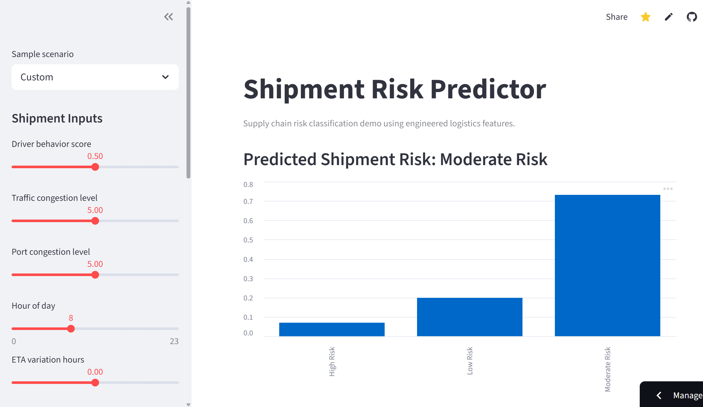

# Supply Chain Risk Classification

Datathon project by **Team Powerhouse** | Machine Learning + Feature Engineering + Logistics Risk Prediction

This project analyzes a synthetic **supply chain logistics dataset** to classify shipment risk levels as **Low**, **Moderate**, or **High**. The work combines exploratory data analysis, domain-inspired feature engineering, SMOTE class balancing, and machine learning models to improve risk prediction and make the model outputs more interpretable for logistics decision-making.

## Project Snapshot

- **Domain:** Supply Chain Analytics / Logistics Risk Management
- **Task:** Multi-class classification
- **Target Variable:** `risk_classification`
- **Risk Classes:** Low, Moderate, High
- **Key Challenge:** Synthetic data patterns, weak feature correlations, shortcut learning, and class imbalance
- **Main Techniques:** EDA, feature engineering, SMOTE, XGBoost, TabTransformer
- **Deliverables:** Modeling notebook and Tkinter-based shipment risk prediction GUI

## Problem

The original dataset contained logistics-related operational features, but the data showed signs of being synthetically generated. Many variables had uniform distributions, weak correlations, and limited real-world dependency patterns. The target classes were also imbalanced, with the majority class dominating the dataset.

The goal of the project was to build a risk classification pipeline that could:

- Understand the structure and limitations of the dataset.
- Reduce majority-class bias through balancing.
- Create more meaningful operational features.
- Train and evaluate classification models.
- Translate model outputs into business-facing logistics insights.

## Tech Stack

- **Language:** Python
- **Data Processing:** pandas, NumPy
- **Visualization:** matplotlib, seaborn
- **Machine Learning:** scikit-learn, XGBoost
- **Class Imbalance Handling:** SMOTE
- **Deep Learning / Tabular Modeling:** TabTransformer
- **Interface Prototype:** Tkinter, Streamlit
- **Notebook Environment:** Jupyter / Google Colab

## Machine Learning Pipeline

1. **Exploratory Data Analysis**
   - Inspected missing values, numerical summaries, distributions, correlations, and GPS-based clustering.
   - Identified synthetic data characteristics such as capped values, uniform spreads, and weak feature relationships.

2. **Feature Engineering**
   - Created domain-inspired features to better represent logistics stress, operational resilience, inventory pressure, clearance friction, and driver-related risk.

3. **Class Balancing**
   - Applied **SMOTE** to address class imbalance and reduce model bias toward the majority risk class.
   - Class distribution changed from `Counter({2: 23944, 1: 5011, 0: 3110})` to balanced classes of `23944` records each.

4. **Modeling and Evaluation**
   - Trained XGBoost and TabTransformer models to predict `risk_classification`.
   - Evaluated results using accuracy, classification reports, confusion matrices, and feature importance plots.

5. **Prototype Interface**
   - Built a Tkinter GUI and Streamlit-ready web app that allow users to adjust shipment-related inputs and generate predicted risk levels.

## Key Feature Engineering

The raw data was dominated by `disruption_likelihood_score`, which created a risk of shortcut learning. To improve interpretability, the project introduced engineered features with clearer business meaning:

- `fuel_efficiency_index`: links fuel consumption with driver behavior.
- `congestion_stress`: combines road and port congestion intensity.
- `logistics_resilience`: measures stability against delays and disruptions.
- `inventory_pressure`: captures demand versus inventory stress.
- `loading_saturation`: represents loading and unloading efficiency.
- `clearance_friction`: combines customs delay and congestion pressure.
- `human_performance_risk`: captures fatigue and behavior-driven operational risk.

## Models Used

- **XGBoost Classifier**
  - Used as the main tree-based classification model.
  - Provided feature importance outputs for model interpretation.

- **TabTransformer**
  - Tested as a deep learning approach for tabular classification.
  - Used to compare neural tabular modeling performance against XGBoost.

## Results and Insights

- The engineered-feature XGBoost model achieved **74.69% accuracy** on the test set.
- The engineered-feature XGBoost classification report showed a **macro F1-score of 0.74**, with class-level F1-scores of:
  - Low risk: **0.80**
  - Moderate risk: **0.76**
  - High risk: **0.68**
- The TabTransformer experiment reached **83.9% validation accuracy** and **57.8% test accuracy**, suggesting weaker generalization compared with XGBoost in this setup.
- A raw-feature XGBoost + SMOTE experiment produced near-perfect accuracy, which reinforced the concern that the raw dataset contained dominant shortcut signals rather than fully realistic logistics relationships.
- Engineered features helped spread importance across multiple operational factors, improving interpretability compared with relying heavily on a single raw variable.

## Business Value

- **Risk Detection:** Supports early identification of high-risk shipments and potential disruptions.
- **Operational Efficiency:** Congestion and clearance-related features can support smarter routing and scheduling decisions.
- **Inventory Management:** Inventory pressure helps identify stockout or overstock risk.
- **Human Factor Control:** Fatigue and behavior-based signals can support safer and more reliable logistics planning.
- **Scenario Planning:** The feature design supports "what-if" analysis for disruptions such as congestion spikes, port delays, or operational stress.

## GUI Demo

The project includes a Tkinter-based prototype for interactive shipment risk prediction.


## Web Demo

Try the deployed Streamlit app here:

**Live Demo:** https://666junyichen-datathon-supply-chain-risk-app-ed7qeh.streamlit.app/



The repository includes a Streamlit app entry point in `app.py`. To run the web demo locally, first export the trained model artifacts:

```bash
python scripts/export_model_artifacts.py --data path/to/dynamic_supply_chain_logistics_dataset.csv
```

This creates:

```text
xgb_model.pkl
scaler.pkl
```

Then start the Streamlit app:

```bash
streamlit run app.py
```

## Project Structure

```text
.
|-- Datathon_Powerhouse.ipynb   # EDA, feature engineering, modeling, and evaluation
|-- app.py                      # Streamlit web demo
|-- GUI.py                      # Tkinter GUI for shipment risk prediction
|-- risk_features.py            # Shared feature engineering logic
|-- requirements.txt            # Python dependencies for local and cloud deployment
|-- scripts/
|   `-- export_model_artifacts.py
|                                  # Trains and saves xgb_model.pkl and scaler.pkl
`-- README.md                   # Project documentation
```

## How to Run

Clone the repository:

```bash
git clone https://github.com/666junyichen/datathon-supply-chain-risk.git
cd datathon-supply-chain-risk
```

Install the main dependencies:

```bash
pip install -r requirements.txt
```

Open the notebook:

```bash
jupyter notebook Datathon_Powerhouse.ipynb
```

Run the GUI prototype:

```bash
python GUI.py
```

Run the Streamlit web app:

```bash
streamlit run app.py
```

## Project Contributions

- Conducted exploratory data analysis to understand synthetic data patterns, feature distributions, and class imbalance.
- Designed domain-inspired features to improve interpretability and reduce reliance on shortcut variables.
- Applied SMOTE to balance the target classes before model training.
- Trained and compared XGBoost and TabTransformer models for shipment risk classification.
- Built a Tkinter GUI prototype to make the model interaction more accessible.
